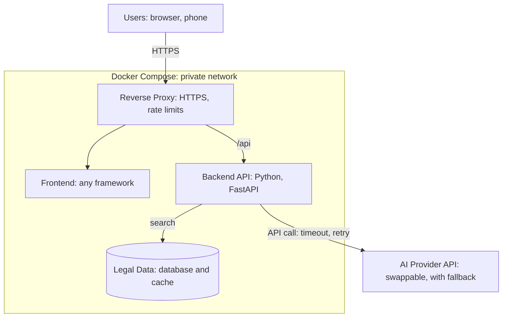

# Technical Architecture Document

**Document ID:** ARCH-001
**Version:** 0.1
**Status:** Draft for Team Review
**Product:** AI-Powered Road Traffic Law and Fine Assistance System for Malawi
**Product Lead:** Tamanga
**Country:** Malawi
**Parent Documents:**
- `PROD-002` Product Vision and Scope
- `PROD-003` Product Requirements Document
- `UX-001` User Experience Specification
- `TASK-001` MVP Work Breakdown and Ownership
- MVP Use Case Diagram and MVP System Architecture Diagram

---

## 1. Purpose

This document defines how the MVP is built: its components, how they communicate, how data and AI are used, how the system is deployed with Docker, and how it stays secure, fault tolerant, and fast.

It describes structure and rules, not code. Specific libraries and products are chosen during implementation, except where this document names them (Python, FastAPI, Docker).

## 2. Architecture Principles

1. **Evidence first.** The AI may only explain evidence that was retrieved from the reviewed legal data. It is never the source of a rule or a penalty.
2. **Honest failure.** When evidence is missing, conflicting, outdated, or the AI is unavailable, the system returns a limitation message. It never guesses.
3. **Modular.** The frontend and the AI provider are replaceable behind fixed contracts. Teams can work in parallel.
4. **Simple.** Few moving parts. Each part has one job.
5. **Secure by default.** Only one entry point is public. Everything else is on a private network.
6. **Stateless backend.** Any backend container can answer any request, so the system can restart or scale without losing anything.

## 3. System Overview



### 3.1 Request Pipeline (inside the Backend API)

1. Validate the request.
2. Search the reviewed legal data.
3. Ask the AI to explain the retrieved evidence in plain language.
4. Check evidence and citations.
5. Return the answer, legal citation, official source link, and a verification note.

## 4. Components

| Component | Responsibility | Technology | Owner (see TASK-001) |
|---|---|---|---|
| Reverse Proxy | The only public entry point. Terminates HTTPS, applies rate limits and security headers, routes pages to the frontend and `/api` to the backend | Any standard reverse proxy container | Vitumbiko |
| Frontend | The web interface described in UX-001 | Team's choice, served as static files | Mphatso |
| Backend API | Validates requests, retrieves evidence, calls the AI, checks the result, builds the response | Python, FastAPI | Valentino, Vitumbiko |
| Legal Data | Stores offences, penalties, versions, source links, source and official-links registers, user reports. Also the cache for repeated lookups | Relational database plus cache | Vitumbiko, Stanley (content) |
| AI Provider Adapter | A single internal interface to any LLM provider, with timeout, retry, and circuit breaker | Python module inside the backend | Valentino |
| AI Provider API | Generates plain-language explanations from supplied evidence | External service, swappable | External |
| Worker (build phase) | Ingests verified records, runs verification checks and evaluation runs outside the request path | Python, same image as the backend with a different command | Papela |

## 5. Backend API Design

### 5.1 Internal Modules

| Module | Job |
|---|---|
| `api` | Routes, request and response schemas, input validation, request IDs |
| `retrieval` | Finds relevant reviewed records for a question |
| `rules` | Decides if the question is supported, ambiguous, or out of scope |
| `ai_adapter` | The only code that talks to an AI provider |
| `checks` | Evidence and citation checks, state decision |
| `lookup` | Penalty and official-link lookup from verified records |
| `reports` | Stores user reports about wrong answers or links |
| `core` | Settings, logging, shared types |

Keeping the AI call inside `ai_adapter` is what makes the AI modular: a new provider means a new adapter class and a configuration change, nothing else.

### 5.2 Endpoints (proposed)

| Method and path | Purpose |
|---|---|
| `POST /api/ask` | Submit a question and receive an answer object |
| `GET /api/sources` | List legal sources and verification status |
| `GET /api/sources/{id}` | Source details and the relevant provision |
| `POST /api/reports` | Report an incorrect answer, citation, or link |
| `GET /api/health` | Liveness and readiness for Docker and monitoring |

Admin and data-loading operations are not public routes. In the MVP they run through the worker or protected scripts.

### 5.3 Response Contract

Every answer carries a `state` so the frontend can render it without guessing. The state values come from UX-001 section 9.

| `state` | Meaning |
|---|---|
| `supported` | Verified evidence supports the answer |
| `insufficient_evidence` | Not enough verified information |
| `conflicting_sources` | Sources disagree |
| `possibly_outdated` | Source status not confirmed current |
| `needs_clarification` | A focused question is needed |
| `technical_failure` | Could not process the request; nothing is confirmed |

Example (illustrative):

```json
{
  "request_id": "b6f1c2",
  "state": "supported",
  "direct_answer": "…",
  "explanation": "…",
  "citations": [
    {
      "source_id": "SRC-003",
      "provision": "Regulation X, Schedule Y",
      "excerpt": "…",
      "verified": true,
      "source_url": "…"
    }
  ],
  "penalty": {
    "prescribed": "…",
    "conditions": "…",
    "record_id": "REC-0142"
  },
  "qualifications": ["…"],
  "official_next_step": { "organization": "…", "url": "…", "verified": true },
  "verification_note": "Checked against the source on …"
}
```

Rules for the contract:
- `penalty` is present only when a verified record supports it.
- `official_next_step.url` is present only when the link is verified.
- A citation that cannot be resolved to a stored source record is removed or the answer is downgraded.
- The response never says a fine is paid or settled.

## 6. Legal Data

### 6.1 Main Entities

| Entity | Key fields |
|---|---|
| Source | `source_id`, title, issuing authority, publication or commencement date, version, official URL, collection date, verification date, review status |
| Record | `record_id`, offence or topic, provision text or summary, section or schedule, `source_id`, version or effective dates, verification status |
| Penalty | `record_id`, prescribed penalty, conditions, qualifications |
| Official Link | name, organization, URL, verification status, last checked date |
| Report | report ID, answer or request ID, category, optional note, status (no personal data required) |

These are derived from PROD-003 FR-001 to FR-004. The Research and Data team owns the final data dictionary.

### 6.2 Publishing Rule

Only records with verification status `verified` are searchable by the backend. Unverified, flagged, or conflicting records exist in the database but are excluded from answers.

### 6.3 Retrieval Approach

The MVP starts with full-text search plus filters on the reviewed records, because the corpus is small and this is simple and fast. Embedding-based search can be added behind the same `retrieval` module if testing shows it is needed. Only the top few matching records are sent to the AI.

### 6.4 Data Update Flow

1. Research and Data prepares and verifies records (second-person check).
2. The worker validates them against the record schema and rejects invalid or unverified ones.
3. Verified records are loaded into the database with source and version IDs.
4. The cache is cleared for affected records.
5. The evaluation test set is run before the update is treated as live.

## 7. AI Integration

### 7.1 Adapter Interface

The backend depends on a small interface, not a vendor:

```python
class AIProvider(Protocol):
    def explain(self, question: str, evidence: list[Evidence]) -> AIResult: ...
```

Each provider is one class implementing this interface. The active provider and the fallback provider are set in configuration.

### 7.2 AI Rules

- The AI receives only the question and the retrieved evidence, plus instructions to use nothing else.
- The AI must return a structured result (explanation text, which evidence IDs it relied on).
- The `checks` module compares the AI output to the evidence. Any penalty, provision, or citation that is not in the evidence causes the answer to be downgraded to a limitation message.
- No personal data is sent to the provider.

## 8. Docker Deployment

### 8.1 Services

| Service | Image | Published port | Notes |
|---|---|---|---|
| `proxy` | Reverse proxy | 443 (and 80 redirecting to 443) | Only service reachable from outside |
| `frontend` | Static file server | none | Reached only through the proxy |
| `backend` | Python app image | none | Stateless, can run multiple replicas |
| `db` | Relational database | none | Data in a named volume |
| `cache` | In-memory cache | none | No persistent data required |
| `worker` | Same image as the backend | none | Run on demand for ingestion and evaluation |

### 8.2 Networks and Volumes

- One private Docker network connects all services. Only `proxy` publishes a port.
- `db` uses a named volume. A scheduled backup copies it elsewhere.
- Configuration and secrets are passed at runtime (environment variables or Docker secrets). They are never written into images or committed to the repository.

### 8.3 Container Standards

- Pinned image versions, no `latest` tags.
- Containers run as a non-root user.
- Read-only filesystem where possible.
- A `healthcheck` on every service and `restart: unless-stopped`.
- The backend image uses a multi-stage build so only what is needed runs in production.
- The `depends_on` conditions wait for healthy services before starting dependents.

### 8.4 Environments

| Environment | Purpose |
|---|---|
| Local | Developers run the full stack with one command |
| Demo and test | A hosted instance for usability testing and presentations |
| Production | Decided after the release decision (Stage 5) |

## 9. Security

| Area | Measure |
|---|---|
| Exposure | Only the reverse proxy is public. Backend, database, and cache are on the private network |
| Transport | HTTPS everywhere on public traffic; security headers set at the proxy |
| Abuse | Rate limits at the proxy and in the API; request size limits |
| Input | Strict validation of every request; length limits; no raw input in database queries (parameterised queries only) |
| Prompt safety | Question text is treated as data, never as instructions to the system; the AI cannot browse or call tools |
| Secrets | Injected at runtime; separate secrets per environment; rotatable |
| Database | Least-privilege database user for the backend (read access to published records, write only to reports) |
| Admin | Data-loading and publishing are separate from the public API and require authentication |
| Privacy | No national ID, licence number, or payment data is collected. Logs contain request IDs and record IDs, not question text with personal details. Retention is decided per UX-001 section 17 |
| Supply chain | Pinned dependencies and base images; regular dependency updates |
| Integrity | Every published record is traceable to its source and verifier |

## 10. Fault Tolerance

| Failure | Behaviour |
|---|---|
| A container crashes | Docker restarts it; health checks stop traffic going to an unhealthy service |
| AI provider slow or down | Timeout, then retry with backoff, then circuit breaker opens and the fallback provider is tried |
| All AI providers fail | The backend returns the verified record text and citation with a clear note that no explanation could be generated. If nothing can be shown, it returns `technical_failure` |
| Database unavailable | Return `technical_failure`; no legal conclusion is displayed |
| Cache unavailable | Skip the cache and read from the database (slower, still correct) |
| Evidence conflicts or is outdated | Return the matching limitation state rather than choosing a side |
| Malformed AI output | Discard it and treat it as an AI failure |
| Bad data update | Records are versioned, so the previous version can be restored |

The backend keeps no state, so replacing or adding containers does not lose user data.

## 11. Performance

Targets are set with the team during Stage 3; initial goals:

- Answer a typical question in a few seconds, with the AI call as the main cost.
- Return cached repeat questions and penalty lookups almost instantly.
- Make the page usable on slow mobile connections (small static frontend).

How the design achieves this:
- Asynchronous API handling and database connection pooling.
- A cache for repeated questions and lookups, cleared when records change.
- Only the top few matching records are sent to the AI, keeping prompts short.
- Heavy work (ingestion, any embedding work) runs in the worker, off the request path.
- Database indexes on offence, provision, and source fields.

## 12. Observability

- Structured logs with a request ID on every request.
- Health endpoint used by Docker and monitoring.
- Basic metrics: request count, error rate, response time, AI call failures, fallback usage, count of each response state.
- Alert on repeated AI failures and on any `supported` answer that failed a citation check.
- Logs must not contain personal data.

## 13. Testing and Evaluation

| Test type | What it checks | Owner |
|---|---|---|
| Unit tests | Modules such as `checks`, `lookup`, `ai_adapter` | Backend and AI team |
| Contract tests | Frontend and backend agree on the response contract | Vitumbiko, Mphatso |
| Evaluation set | Retrieval relevance, citation correctness, penalty correctness, uncertainty handling, using the Research and Data question set | Papela |
| Failure tests | Empty evidence, conflicting sources, outdated source, malformed AI output, AI provider failure, database down | Papela |
| Security checks | Exposure, input validation, secrets handling, dependency scan | Vitumbiko |
| Usability tests | UX-001 acceptance criteria on desktop and mobile | Richard, Mphatso |

Release blockers (PROD-002 section 11): fabricated provision, unsupported penalty, misleading citation, false payment confirmation, unverified official link shown as official.

## 14. Requirements Traceability

| Requirement | Where it is handled |
|---|---|
| FR-001 Register legal sources | Source entity, worker ingestion |
| FR-002 Structure legal provisions | Record and Penalty entities |
| FR-003 Validate legal records | Verification status; worker validation; only `verified` is searchable |
| FR-004 Track legal versions | Version fields; versioned updates and rollback |
| FR-005 Accept natural-language questions | `POST /api/ask`, input validation |
| FR-006 Identify the question's subject | `rules` module |
| FR-007 Retrieve legal evidence | `retrieval` module, insufficient-evidence result |
| FR-008 Evidence-grounded answers | AI adapter plus `checks` |
| FR-009 Legal citations | Citation objects resolved to source records |
| FR-010 Prescribed penalties | `lookup` module from verified records |
| UX-001 section 9 failure states | Response `state` field |
| Official guidance links | Official Link entity, shown only when verified |

## 15. Risks and Mitigations

| Risk | Mitigation |
|---|---|
| AI adds claims not in the evidence | `checks` module compares output to evidence; downgrade on mismatch |
| AI provider outage or change | Adapter plus fallback provider |
| Wrong or outdated data | Second-person verification, versioning, update procedure, user reports |
| Public abuse or cost spikes | Rate limits, request size limits, caching |
| Single server failure | Auto-restart, backups, ability to redeploy from images and the database backup |
| Over-complexity | Start with one backend, one database, simple search; add parts only when testing proves the need |

## 16. Out of Scope for the MVP

- User accounts and saved history
- Direct payment processing or access to government enforcement systems
- Voice input and native mobile apps
- Automatic scaling across multiple servers (the design allows it later)
- A full admin console (MVP uses protected scripts or a minimal tool)

## 17. Open Decisions

| # | Decision | Needed by |
|---|---|---|
| 1 | Hosting provider and budget for demo and test environments | Stage 3 |
| 2 | Which AI provider is primary and which is fallback | Stage 2 |
| 3 | Whether embedding search is needed beyond full-text search | After first evaluation run |
| 4 | Whether conversation text is retained for evaluation, and for how long | Before any logging of questions |
| 5 | English only or Chichewa as well (affects prompts, search, and testing) | Stage 2 |
| 6 | Latency and availability targets | Stage 3 |
| 7 | Backup frequency and restore test procedure | Stage 3 |

## 18. Approval

**Document status:** Draft for Team Review
**Reviewers:** Vitumbiko (platform), Valentino (AI), Papela (testing), Mphatso (frontend contract), Stanley and Bizwell (data model), Tamanga (approval)
**Next recommended documents:** Data Dictionary, API Specification (OpenAPI), Testing Plan
